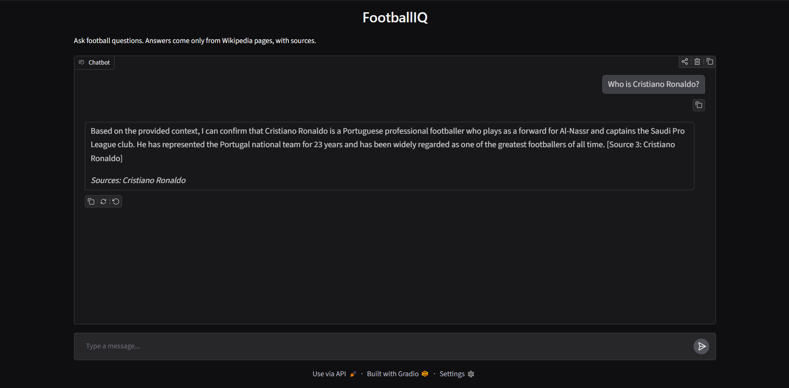

# FootballIQ

A football Q&A assistant built with retrieval-augmented generation (RAG). It answers from 16 Wikipedia pages, cites its sources, and says so when the pages don't cover a question. The focus of the project is **measuring retrieval quality** and improving it one change at a time.



**Demo page:** [DEMO_LINK](https://github.com/LakshmiKanth11/FOOTBALLIQ/blob/main/index.html)
DOWNLOAD THIS DEMO PAGE  AND VIEW IT IN WEB BROWSERS.
(screenshots and results; the app itself runs locally)

## HOW TO RUN IT FROM STARTING IF YOU DOWNLOAD THE REPO DIRECTLY 
## Quick start (for anyone downloading this repo)

**You need:** Python 3.10 or newer, an internet connection, and a free Gemini API key from [aistudio.google.com](https://aistudio.google.com). The first run downloads about 400 MB of models.

> **Important: keep the virtual environment (`.venv`) active.**
> Every command from Step 2 onward must be run with `(.venv)` showing at the start of your terminal line. **Every time you open a new terminal, activate it again** (Step 2). If you skip this, you'll get `No module named ...` errors.

### 1. Get the code (no `.venv` needed)

```bash
git clone https://github.com/LakshmiKanth11/FOOTBALLIQ.git
cd FOOTBALLIQ
```

Or click **Code → Download ZIP** on GitHub, unzip it, and open a terminal inside the folder.

### 2. Create and activate the virtual environment

Create it **once**:

```bash
python -m venv .venv
```

Activate it **every time you open a new terminal**:

- Windows: `.venv\Scripts\activate`
- Mac/Linux: `source .venv/bin/activate`

Check that your terminal line now starts with `(.venv)`.

### 3. Install the libraries (`.venv` must be active)

```bash
pip install -r requirements.txt
```

If this fails, install without pinned versions:

```bash
pip install chromadb sentence-transformers rank-bm25 google-genai python-dotenv wikipedia-api fastapi uvicorn gradio
```

### 4. Add your settings (no `.venv` needed)

1. Create a file named `.env` in the project folder with one line, with no spaces around `=` and no quotes:
   ```
   GOOGLE_API_KEY=your_key_here
   ```
2. Open `app/ingest.py` and replace `your_email@example.com` in the `user_agent` line with your own email.

### 5. Build the knowledge base, once (`.venv` must be active)

```bash
python app/ingest.py
python app/embed.py
```

Wait for `Done! Database now holds ... chunks`.

### 6. Run it (`.venv` must be active)

Chat window:

```bash
python chat_ui.py
```

Open http://127.0.0.1:7860 (not `0.0.0.0`).

Or the API:

```bash
uvicorn app.main:app --reload
```

Open http://127.0.0.1:8000/docs and use `POST /ask`.

Evals (also with `.venv` active, run from the project folder):

```bash
python -m evals.eval_big
```

### Troubleshooting

| Problem | Fix |
|---|---|
| `No module named 'google'` (or any library) | `.venv` isn't active. Run the activate command from Step 2 and check for `(.venv)`. |
| `No module named 'app'` | Run files from the project folder with `python -m ...`, not a play button. |
| `503` or `429` from Gemini | Google is busy or rate-limited. Wait a few minutes. The app retries and tries a second model. |
| "No AI model is available right now" | Gemini is unavailable and no local model is installed. Retry later, or install [Ollama](https://ollama.com) and run `ollama pull llama3.2`. |
| Dimension error such as "expecting 768, got 384" | `embed.py` and `retrieve.py` use different embedding models. Make them match and re-run `python app/embed.py`. |
| PowerShell says scripts are disabled when activating | Run `Set-ExecutionPolicy -Scope CurrentUser RemoteSigned`, type `Y`, then activate again. |
| Browser error at `0.0.0.0` | Use `127.0.0.1` instead. |

## How it works

```
Wikipedia pages -> chunks -> embeddings -> ChromaDB --+
                                                      +-> hybrid search -> Gemini -> answer + sources
                                  BM25 keyword index -+
```

1. **Ingest:** download 16 Wikipedia pages (players, clubs, tournaments, rules) and split them into 200-word chunks with 40-word overlap (854 chunks).
2. **Embed:** embed each chunk with `all-mpnet-base-v2`, with the page title prepended, and store the vectors in ChromaDB.
3. **Retrieve:** hybrid search. Embedding search (meaning) and BM25 (exact words) are merged with reciprocal rank fusion.
4. **Generate:** the top 4 chunks go to Gemini with a prompt to answer only from the context, cite `[Source N]`, and say "I don't have enough information on that" otherwise.
5. **Resilience:** the LLM call retries on errors, tries a second Gemini model, then falls back to a local Ollama model (`llama3.2`).

## Stack

Python, sentence-transformers, ChromaDB, rank-bm25, FastAPI, Gradio, Gemini API (`google-genai`), Ollama (optional fallback).

## Project structure

```
footballiq/
├── app/
│   ├── ingest.py        # download + chunk Wikipedia -> data/chunks.json
│   ├── embed.py         # embed chunks -> ChromaDB (data/chroma)
│   ├── retrieve.py      # hybrid search (embeddings + BM25)
│   ├── generate.py      # prompt + LLM call with retry and fallback
│   └── main.py          # FastAPI app (/ask, /health)
├── evals/
│   ├── eval_retrieval.py     # 22 easy questions (hit rate, MRR)
│   ├── eval_hard.py          # 20 harder questions (page hit, answer hit)
│   ├── eval_big.py           # 24 questions tagged by type, keywords validated
│   ├── eval_faithfulness.py  # refuses out-of-scope, answers in-scope
│   ├── debug_miss.py         # inspect why a question failed
│   └── debug_japan.py        # inspect retrieved text for one question
├── chat_ui.py           # Gradio chat interface
├── list_models.py       # list Gemini models available to your key
├── test_llm.py          # quick check that the LLM responds
├── screenshots/chat.png
└── requirements.txt
```

## Setup (Windows)

```bash
git clone https://github.com/LakshmiKanth11/FOOTBALLIQ.git
cd FOOTBALLIQ
python -m venv .venv
.venv\Scripts\activate
pip install -r requirements.txt
```

On Mac/Linux, activate with `source .venv/bin/activate`.

Create a `.env` file in the project root (never commit it):

```
GOOGLE_API_KEY=your_key_here
```

Get a key at [aistudio.google.com](https://aistudio.google.com). In `app/ingest.py`, replace `your_email@example.com` in `user_agent` with your own email (Wikipedia asks for this).

Optional: install [Ollama](https://ollama.com) and run `ollama pull llama3.2` to enable the local fallback.

## Run

Build the knowledge base once:

```bash
python app/ingest.py
python app/embed.py
```

Chat UI:

```bash
python chat_ui.py
```

Open http://127.0.0.1:7860 in your browser.

API:

```bash
uvicorn app.main:app --reload
```

Open http://127.0.0.1:8000/docs and use `POST /ask` with `{"question": "Who is Cristiano Ronaldo?"}`. `GET /health` is a liveness check.

Terminal chat and evals (run from the project root, using `-m`):

```bash
python -m app.generate
python -m evals.eval_retrieval
python -m evals.eval_hard
python -m evals.eval_big
python -m evals.eval_faithfulness
```

Optional: set `LLM_MODE` to `gemini` or `local` to pin the model, for example in PowerShell: `$env:LLM_MODE="gemini"`.

## Retrieval experiments

Two hand-written test sets. **Page hit:** the right Wikipedia page is in the top 4. **Answer hit:** a keyword from the answer appears in those 4 chunks. **MRR:** how high the right page ranks (1.00 means always first).

| Experiment | Page hit | Answer hit | Easy set (hit / MRR) |
|---|---|---|---|
| Baseline: MiniLM, top 4 | 95% | 95% | 100% / 0.98 |
| A: top 8 | 95% | 95% | not run |
| B: page title added to each chunk | 100% | 90% | 100% / 0.98 |
| C: B + `all-mpnet-base-v2` | 100% | 95% | 100% / 0.94 |
| D: C + hybrid search (BM25) | 95% | 100% | 100% / 0.98 |

Rows A to D use the 20-question hard set.

### Larger set

24 more questions, tagged by type. Each keyword was checked against the indexed chunks before scoring.

| Type | Questions | Page hit |
|---|---|---|
| Direct (names the entity) | 10 | 10 / 10 |
| Paraphrase (describes it) | 8 | 8 / 8 |
| Multi-fact (needs two ideas) | 6 | 5 / 6 |

Across all three sets (66 questions), the right page was in the top 4 for 64.

## Faithfulness check (preliminary)

Does the system refuse questions the pages don't cover, and still answer the ones they do?

| Run | Refusals | Answers | Notes |
|---|---|---|---|
| Original prompt | 6/7 | 5/5 | Mixed Gemini and local model |
| Stricter prompt ("no outside knowledge, cite only explicit facts") | 9/9 | 4/5 | Mixed models; the miss was a local-model refusal |

On a Gemini-only run, "What is the capital of Japan?" was still answered from a passing mention of Tokyo in a World Cup page, so the stricter prompt did not clearly fix that case. Most other questions in that run were skipped because of API rate limits (HTTP 429). A clean Gemini-only rerun is still to do.

## What I learned

- Retrieving more results (A) changed nothing. The misses were ranking problems, not a cutoff problem.
- Embeddings missed an exact phrase ("held every four years"). Adding BM25 keyword search fixed it.
- The index and the search must use the same embedding model, or the vector sizes don't match and the search fails.
- Wikipedia pages mention many things in passing, so a prompt that says "use only the context" can still be satisfied by an implied answer.
- With 20 to 66 questions, one question moves a score by several points. These numbers are signals, not proof.

## Limitations

- **Not hosted.** The hosts I checked charge for apps that run Python, so the app runs locally and the demo page shows it.
- **Small, friendly test sets.** Keyword checks can pass by accident, so page hit is the more reliable metric.
- **Known miss:** "Which player won the Ballon d'Or and the 2022 World Cup?" fails, because the question never names Messi.
- **Faithfulness results are preliminary** (see above).
- **Narrow data:** 16 Wikipedia pages.
- **LLM availability:** Gemini returned intermittent 503 and 429 errors during development, which is why retries and fallbacks exist.

## Roadmap

- [ ] Clean Gemini-only faithfulness run
- [ ] Query rewriting for multi-fact questions
- [ ] More pages and a larger, tougher eval set
- [ ] Live hosting
